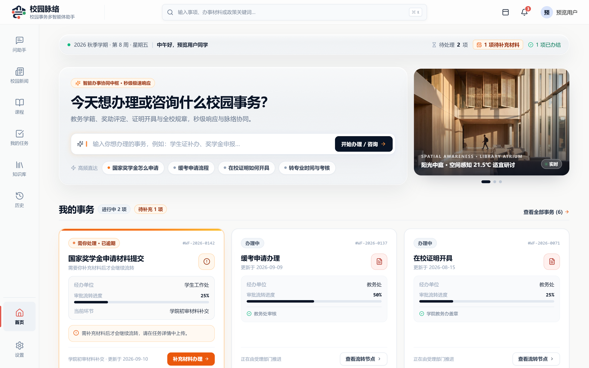
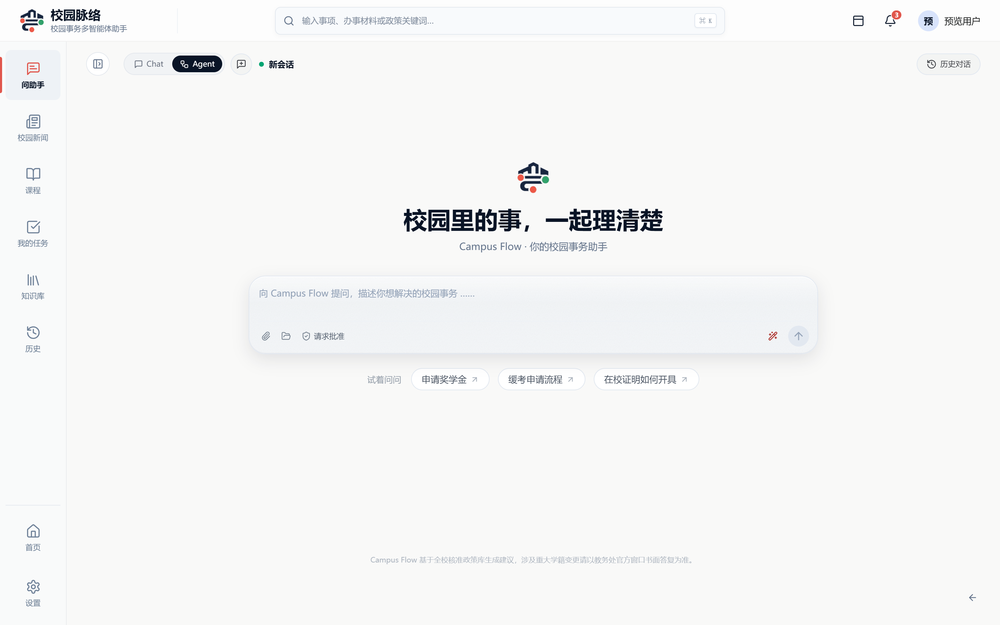
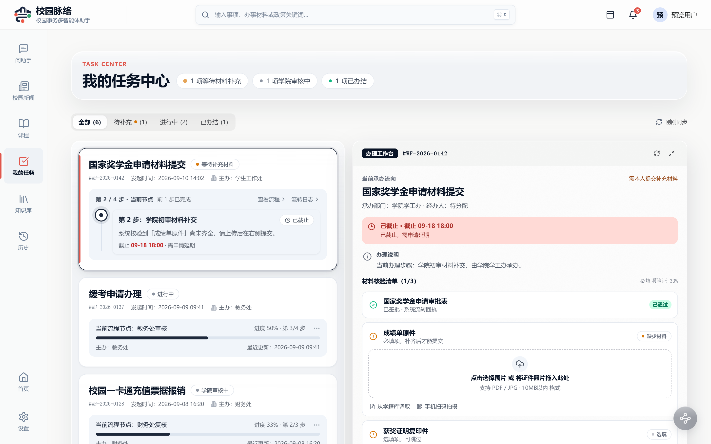
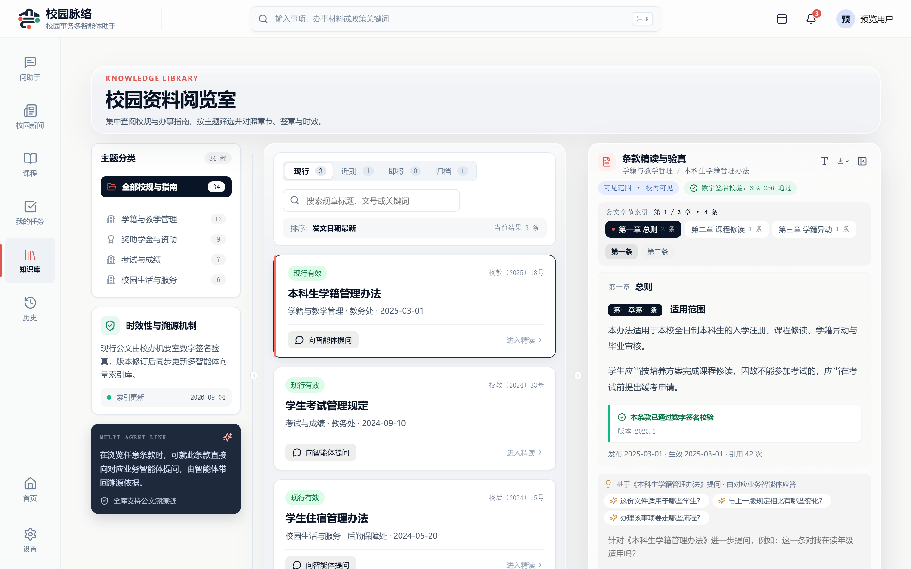
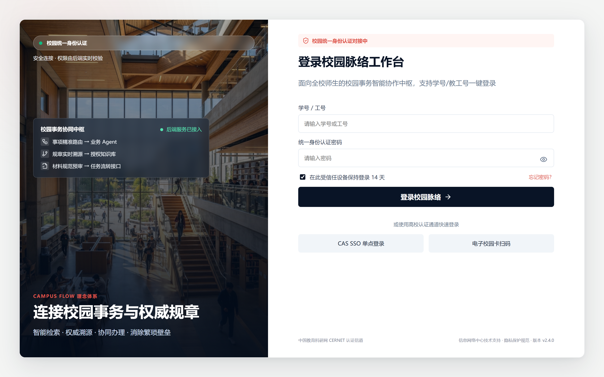
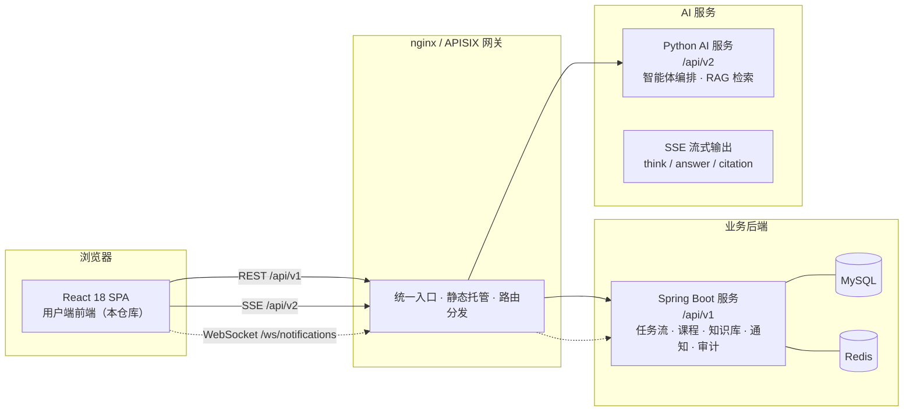

# Campus Flow · 校园脉络 — 用户端 Web 前端

> 面向全校师生的校园事务智能协作平台（用户端）。把奖学金申请、缓考、在校证明这类「要跑多个部门、翻多个文件」的校园事务，收敛成一个由 AI 智能体驱动的协作工作台：能问、能办、能追进度、能溯源到权威条文。

   

## 页面速览

| 首页 | AI 助手（问办一体） |
| --- | --- |
|  |  |

| 任务中心（全流程可追踪） | 校园资料阅览室（条文级溯源） |
| --- | --- |
|  |  |

| 登录 |
| --- |
|  |

## 核心能力

- **AI 助手（问办一体）**：单轮对话内同时支持「问」（知识库检索、条文溯源、引用标注）与「办」（解析出待办、一键立项）；回答支持思考过程折叠（`reasoning_content`）、引用回链、追问推荐。
- **任务中心**：AI 立项后进入多节点审批流（学生 → 学院 → 职能部门），逐节点可见「当前环节、停留节点、需补材料」；支持补充材料上传、催办、流转转点。
- **校园资料阅览室**：按主题分类的校规校策聚合，条文按「现行 / 近期 / 即将 / 归档」分效力状态展示，可基于条文直接向智能体提问。
- **实时通知**：WebSocket（STOMP）推送 + 轮询降级双通道，徽标未读数、全局公告 toast。
- **权限与角色**：学生 / 教师 / 管理员多角色路由守卫与管理端入口。

## 技术栈与架构

React 18 + TypeScript + Vite + Zustand + React Router；测试用 Vitest；流式回答走 SSE。



前端关键约定：

- 所有业务请求收敛在 `src/services/`，接口类型唯一出处为 `src/types/api.ts`；
- 时间参数一律发本地墙钟或显式 `+08:00`（后端原样进 SQL，不认 UTC `Z`）；
- 提问接口为 `multipart/form-data`（文本 + 附件），回答经 SSE 分事件流式渲染；
- 列表接口缺字段时先补后端契约，前端不批量补发详情兜底。

## 快速开始

```bash
# Node.js 20+ / pnpm 9+
pnpm install

# 配置后端地址（可参考 .env.example）
cp .env.example .env.local

pnpm dev        # 开发服务器
pnpm build      # 类型检查 + 产物构建
pnpm lint       # ESLint
pnpm test       # Vitest 单测
```

`.env.local` 关键项：

| 变量 | 说明 |
| --- | --- |
| `VITE_API_BASE_URL` | 业务后端 `/api/v1` 基础路径 |
| `VITE_AI_API_BASE_URL` | AI 服务 `/api/v2` 基础路径 |
| `VITE_UPLOAD_MAX_MB` | 附件上传上限（MB） |

## 目录结构

```
src/
├── app/          # 路由、应用壳、登录守卫
├── pages/        # 路由级页面（助手 / 任务 / 课程 / 知识库 / 历史等）
├── components/   # 通用 UI 组件
├── services/     # 全部业务请求（Axios）与 SSE / WebSocket 客户端
├── stores/       # Zustand 会话状态
├── types/        # API 类型唯一出处
├── utils/        # 纯函数工具（含对应单测）
└── styles/       # 全局与页面样式
```

## 相关仓库分支

本仓库按「一个分支一个子项目」组织：

| 分支 | 内容 |
| --- | --- |
| `frontend-web`（本分支） | 用户端 Web 前端 |
| `main` | 管理端前端 |
| `master` | Python AI 服务（智能体编排 / RAG） |
| `backend-java` | Java 业务后端（Spring Boot 多模块） |

## 说明

- 仓库内学生数据（`course-grab-students.csv`、数据库设计 SQL 种子数据）均为压测 / 开发用合成数据，邮箱统一为 `@campusflow.test`，不含任何真实个人信息；
- 数据库结构以 `校园事务智能助手数据库设计.sql` 为唯一真相源，接口行为以 `校园事务智能助手后端接口文档.md` 为契约。
