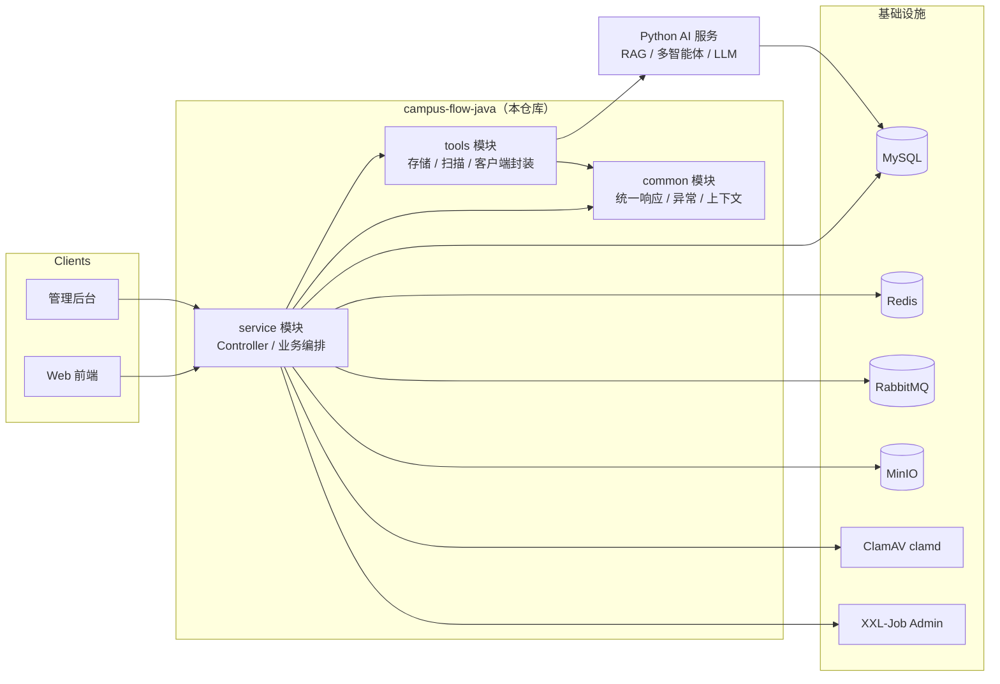

# CampusFlow 后端（campus-flow-java）

校园综合服务平台后端：围绕**选课、办事任务、知识库（RAG 问答）、校园资讯、文件安全审核、通知与管理后台**提供 REST API。采用 Maven 多模块（`common` / `tools` / `service`）+ 独立 Python AI 服务协作的架构，AI 能力（LLM / RAG / 多智能体）由 Python 服务承载，Java 侧通过 HTTP 编排调用。

> 本仓库 `backend-java` 分支为 Java 后端；`main` 分支为管理后台前端。

## 技术栈

| 分类 | 选型 |
|---|---|
| 框架 | Java 17 · Spring Boot 3.3.5 · Spring AI · MyBatis-Plus · WebSocket |
| 数据 | MySQL · Redis（Lua / Bitmap / Stream） · RabbitMQ |
| 中间件 | MinIO（对象存储） · XXL-Job（分片调度） · ClamAV（病毒扫描） |
| 云服务 | 腾讯云 TMS 文本审核 / IMS 图片审核 / OCR（可选，未配置自动跳过） |
| AI | DeepSeek API（Java 直连）+ Python AI 服务（RAG / 多智能体） |

## 架构



## 核心设计亮点

### 高并发选课链路

请求经过「一次性幂等令牌 → Redis Lua 原子校验与扣减 → Redis Stream 异步落库」三级处理，数据库写压力与抢课洪峰完全解耦：

- **单段 Lua 脚本原子完成十余步操作**（`lua/enrollCourse.lua`）：幂等校验、重复选课校验、开课状态校验、库存扣减、时间冲突检测、选课入队（`XADD` 直接写在脚本里），杜绝检查-执行竞态与超卖；
- **Bitmap 课表冲突检测**：学生已选课表与目标班课表各编码为一个 Bitmap，`BITOP AND` + `BITCOUNT` 一次位运算判定冲突，替代多表 JOIN 逐时段比对；
- **Redis Stream + XXL-Job 分片广播消费者**：消费失败不 ACK 留在 PEL，`XCLAIM` 认领空闲超时消息自动重试；已选人数按选课记录 `COUNT` 重算回填，消费侧天然幂等；
- **退课最终一致性**：DB 侧 `SELECT ... FOR UPDATE` 行锁 + `enrolled_count > 0` 条件更新防并发重复扣减；事务提交后（afterCommit）才释放 Redis 名额并重建学生位图；
- 所有 Key 以学期编码 `{termCode}` 作 Hash Tag 分域，兼容 Redis Cluster 多槽约束。

### 文件安全审核链

上传文件走「ClamAV 病毒扫描 → MIME/魔数校验 → 正文抽取（PDFBox/POI，超限截断）→ 腾讯云 TMS 文本审核 → IMS 图片审核 → LLM 语义补充」多级流水线；扫描版 PDF 由 OCR 兜底救回文字后再送审；僵死任务由 XXL-Job 补偿重投（静默超时判定 + 有界重试）。未配置云密钥时对应层级自动跳过（明确记为"未审"，绝不静默放行）。

## 模块结构

```text
campus-flow-java
├── pom.xml            # 父 POM：统一依赖版本管理
├── common/            # 公共基础层：统一响应/全局异常/枚举/上下文/注解
├── tools/             # 基础设施层：MinIO 存储、ClamAV 扫描、内容审核、JWT、Redis 封装
└── service/           # 业务层：全部 Controller / Service / Mapper / 实体
    └── src/main/resources/
        ├── lua/       # 选课/退课 Lua 脚本
        ├── mapper/    # MyBatis XML
        └── db/        # DDL 与种子数据脚本
```

依赖方向：`service → common / tools`，`tools → common`，反向依赖不存在。

## 快速开始

### 环境要求

- JDK 17+、Maven 3.8+
- MySQL 8、Redis 6.2+、RabbitMQ、MinIO（本地可用 Docker 起）
- （可选）ClamAV clamd、XXL-Job Admin、Python AI 服务——不部署时对应功能自动降级

### 配置

所有密码/密钥**一律通过环境变量注入**，仓库内不含任何真实凭据：

| 环境变量 | 说明 |
|---|---|
| `MYSQL_URL` / `MYSQL_USERNAME` / `MYSQL_PASSWORD` | 数据库连接 |
| `REDIS_HOST` / `REDIS_PASSWORD` | Redis |
| `RABBITMQ_PASSWORD` | RabbitMQ |
| `MINIO_ACCESS_KEY` / `MINIO_SECRET_KEY` | 对象存储 |
| `JWT_SECRET` | JWT 签名密钥（生产必须覆盖） |
| `DEEPSEEK_API_KEY` | DeepSeek API |
| `TENCENT_TMS_SECRET_ID` / `TENCENT_TMS_SECRET_KEY` | 腾讯云审核/OCR（留空则跳过该层） |

也可以把私有值写在 `service/src/main/resources/application-local.yml`（已被 `.gitignore` 排除），以 `--spring.profiles.active=dev,local` 启动。

### 构建与运行

```bash
# 构建
mvn -pl service -am package -DskipTests

# 运行
java -jar service/target/service-*.jar --server.port=8080
```

启动后访问 `http://localhost:8080/swagger-ui.html` 查看接口文档，`/actuator/health` 查看健康状态。

## 安全说明

- 仓库历史中不含真实密钥；云 API 密钥、数据库密码均以 `${ENV_VAR:}` 占位形式提交；
- 历史提交若存在早期密钥，请以各云控制台**轮换密钥**为准，而非依赖删除提交；
- `application-local.yml`、`logs/`、`target/` 等本地私有内容均已加入 `.gitignore`。

## 相关仓库分支

| 分支 | 内容 |
|---|---|
| `backend-java` | 本仓库 Java 后端（当前分支） |
| `main` | 管理后台前端 |
| `master` | Python AI 服务（RAG / 多智能体） |
