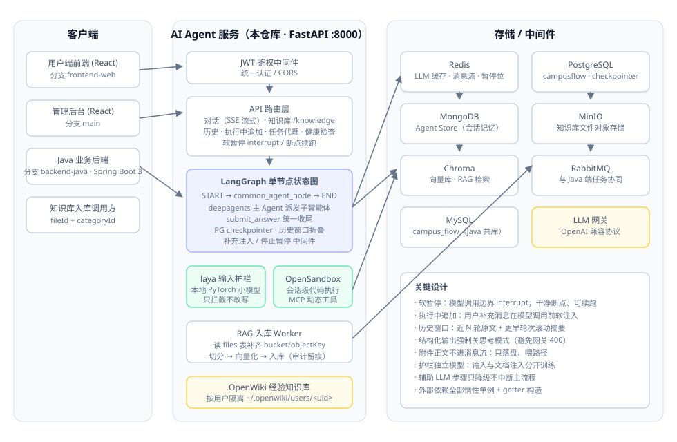

# CampusFlow · AI Agent 智能问答服务（Python）

CampusFlow 校园智能助手的 **AI Agent 服务端**：基于 LangGraph 的单节点状态图 + deepagents 多子智能体调度，提供 SSE 流式对话、RAG 知识库检索、本地小模型输入护栏与会话级代码沙箱。

> 仓库采用多分支组织：
> `backend-python`（本分支）· [`backend-java`](../../tree/backend-java)（Spring Boot 3 业务后端）· [`frontend-web`](../../tree/frontend-web)（用户端前端）· `main`（管理后台 + 总览 README）

## 核心特性

- **SSE 流式对话**：打字机式实时输出；`submit_answer` 唯一收尾出口，流式与校验顺序解耦
- **软暂停 / 断点续跑**：第一次点击「停止」在模型调用边界 `interrupt()` 干净暂停，不产生悬空 tool_calls；「继续」从断点恢复，不重放已执行的工具调用；连点/超时才走硬取消
- **执行中追加**：回答生成过程中用户可补充消息，经中间件在下一轮模型调用前软注入，不中断当前流
- **历史上下文窗口**：近 N 轮保留原文，更早轮次折叠为滚动摘要，兼顾上下文长度与连贯性
- **输入安全护栏（laya）**：本地微调的 PyTorch 小模型对提示词注入 / 越权 / 敏感数据预筛选，「只拦截、不改写」；输入模型与文档注入模型独立训练、独立部署
- **RAG 知识库**：两段式「上传 ≠ 入库」，入库时从同库 `files` 表补齐对象存储坐标，切分→向量化→Chroma 入库全程审计留痕；支持冲突文档扫描
- **会话级代码沙箱**：OpenSandbox 隔离执行用户代码，空闲会话自动回收，MCP 工具动态加载
- **OpenWiki 经验沉淀**：按用户隔离的 Wiki 知识库，蒸馏沉淀 + 用户画像关联，与 RAG 检索协同

## 架构



**对话链路**：客户端 → JWT 中间件 → 对话路由（SSE）→ LangGraph 单节点图 → deepagents 主 Agent 按需派发子智能体 → 工具执行（RAG 检索 / 校园业务 API / OpenWiki / 沙箱代码）→ `submit_answer` 统一收尾 → SSE 流式回传。

## 技术栈

| 层 | 技术 |
| --- | --- |
| Web 框架 | FastAPI + Uvicorn，SSE 流式响应 |
| Agent 编排 | LangGraph（单节点状态图）+ deepagents（子智能体）+ LangChain |
| 安全护栏 | 本地微调 PyTorch 小模型（laya），CPU/GPU 双验证 |
| 向量检索 | Chroma |
| 存储 | PostgreSQL（checkpointer）· Redis（缓存/消息流）· MongoDB（Agent Store）· MySQL（与 Java 共库）· MinIO |
| 异步协同 | RabbitMQ（与 Java 端队列对齐） |
| 代码执行 | OpenSandbox + MCP |
| 配置 | pydantic-style 环境变量 + `uv` 依赖管理 |

## 快速启动

```bash
# 1. 安装依赖（uv）
uv sync

# 2. 配置环境变量
cp .env.example .env
#    编辑 .env：填入 LLM 网关、Redis/PG/Mongo/MinIO/RabbitMQ 等连接信息

# 3. 启动（Windows 下 run.py 已处理事件循环策略）
python run.py
#    服务监听 http://127.0.0.1:8000

# 4. 健康检查
curl http://127.0.0.1:8000/health
```

> Windows 提示：`run.py` 内已切换 `WindowsSelectorEventLoopPolicy`（psycopg 异步驱动要求），请通过 `python run.py` 启动而非裸 `uvicorn`。

### 主要接口

| 方法 | 路径 | 说明 |
| --- | --- | --- |
| POST | `/conversations`（SSE） | 创建会话并发起流式问答 |
| POST | `/knowledge/*` | 知识库入库 / 状态 / 管理（fileId + categoryId 契约） |
| GET | `/history/*` | 会话历史 |
| GET | `/health` | 健康检查 |

## 项目结构

```
src/
├── api/            # FastAPI 路由：对话(SSE)、知识库、历史、任务代理、健康检查
├── agent/
│   ├── nodes/      # LangGraph 节点（common_agent_node）
│   ├── prompt/     # 主/子智能体提示词
│   ├── tools/      # RAG 检索、校园业务 API、OpenWiki、laya 护栏、搜索
│   ├── rag_worker/ # 知识库入库：切分、冲突扫描、审计
│   ├── sandbox/    # OpenSandbox 会话级代码执行
│   ├── cache/      # LLM Redis 缓存
│   └── llm/        # 模型接入、reasoning_effort 收敛、历史窗口
├── cache/          # Redis 客户端（惰性单例）
├── db/             # MySQL 共库访问（参数化 SQL，不建 ORM）
├── jwt/            # JWT 鉴权中间件
└── repositories/   # 会话/消息仓储、SSE 流管理
```

## 安全说明

- 所有密钥经 `.env` 注入（见 `.env.example` 模板），`.env` 已被 `.gitignore` 排除，不进版本库
- 数据库连接串、对象存储账密、模型路径均可通过环境变量覆盖
- JWT 中间件统一鉴权；跨库写操作使用参数化 SQL
- 历史提交中不含任何真实凭证
