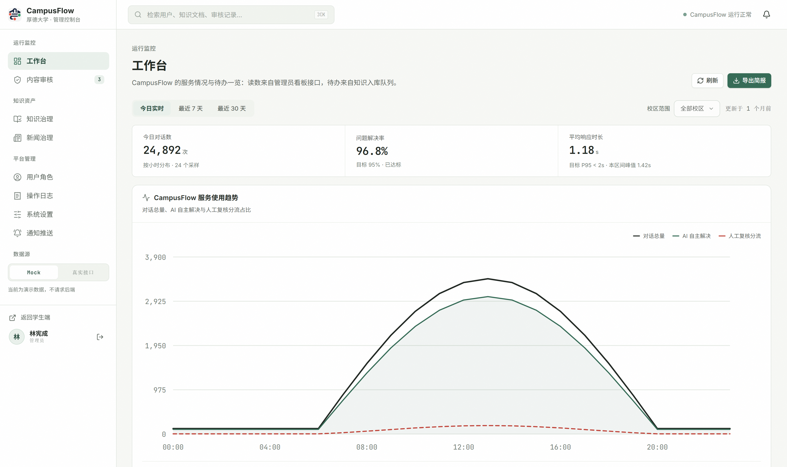
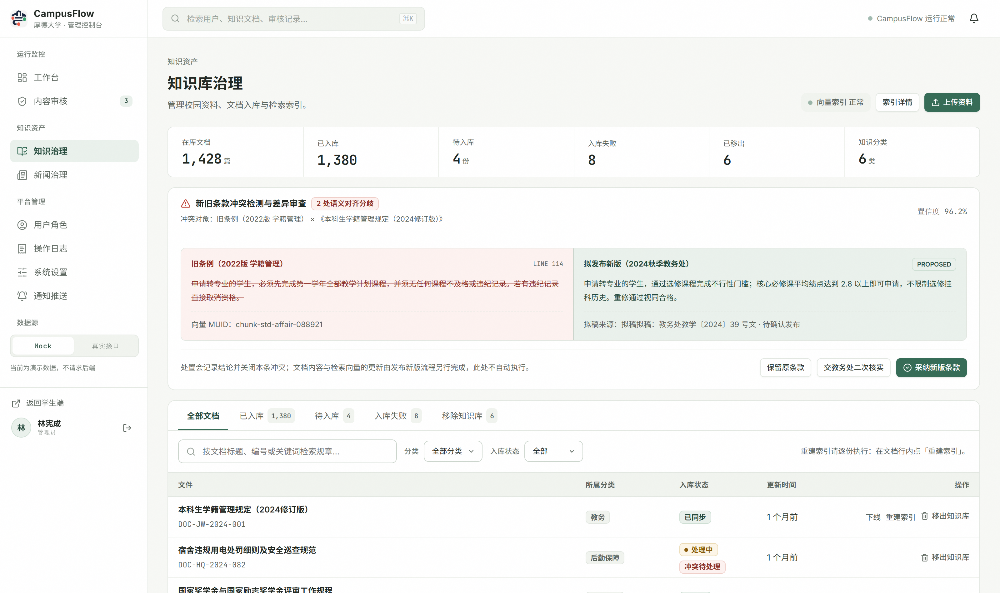
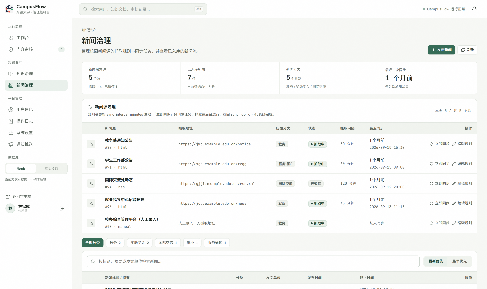
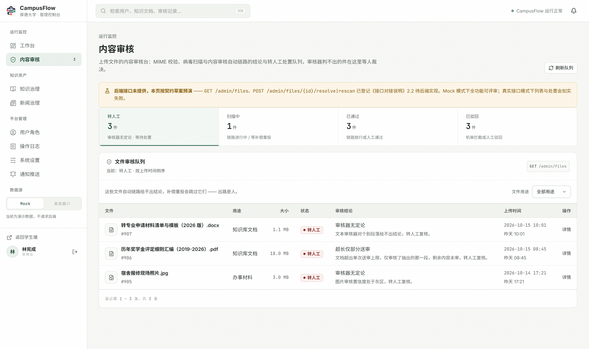
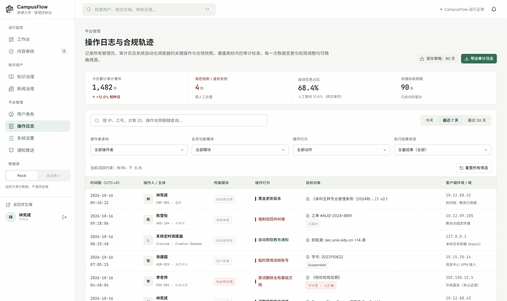
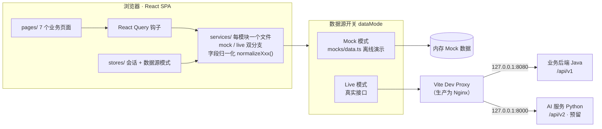

# CampusFlow Admin · 校园脉络管理后台

校园事务多智能体助手（CampusFlow）的**管理端控制台**。面向高校管理员，提供智能体服务的运行监控、知识库治理、新闻源治理、文件内容审核与审计合规能力。

- **技术栈**：React 19 · TypeScript · Vite · React Query · Zustand · 手写设计系统（无 UI 组件库依赖）
- **界面**：按 6 张设计稿原型开发，设计系统遵循 Academic Precision 规范——纸墨基调、1px 结构线分层、数字一律 `tabular-nums`
- **数据源双模式**：内置 Mock 数据可离线演示；一键切换真实接口联调（service 层每函数双分支）

## 页面速览

| 工作台 | 知识库治理 |
| --- | --- |
|  |  |

| 新闻治理 | 内容审核 |
| --- | --- |
|  |  |

| 登录（角色闸门演示） | 操作日志 |
| --- | --- |
|  |  |

## 架构



几个关键设计决策：

- **业务失败 ≠ HTTP 错误**：后端约定业务失败返回 HTTP 200 + 非 0 `code`。`services/http.ts` 统一提供 `ensureApiSuccess` 判别，逐调用点包裹——审计日志的空结果（404）要渲染成空页而不是报错。
- **Mock 是契约的第二实现**：接口字段一变必须同步改 mock；mock 少实现一条筛选 = 契约少一条。
- **不放兜底假数据**：指标只显示接口真数字，缺失值显示「—/未回传」——空白像 bug，假数字像事实。
- **角色闸门在前端**：后端暂无管理端专用登录入口，复用 `POST /auth/login` 后校验 `role === 'admin'`，非管理员登录在写入会话**之前**清除令牌，避免状态泄漏。

## 快速开始

```bash
npm install
npm run dev      # 默认 5174，被占用时自动顺延
npm run build    # tsc -b && vite build
npm run test     # vitest
```

打开后是登录页。数据源默认使用内置 **Mock 数据**（数值与设计稿一致），可在左侧栏底部切换到**真实接口**。

Mock 模式下的演示账号（**任意密码**）：

| 账号 | 身份 | 结果 |
| --- | --- | --- |
| `10008892` | 林宪成 · 超级管理员 | 正常进入 |
| `2022010834` | 林晨 · 学生 | 被角色闸门拦下，演示「非管理员无法进入管理后台」 |

真实接口模式下走 `POST /auth/login` + `GET /users/me`，逐条接口映射见 [接口对接说明.md](./接口对接说明.md)。

## 七个页面

| 路由 | 页面 | 说明 |
| --- | --- | --- |
| `/observatory` | 系统观察（工作台） | 运行监控、服务使用趋势、异常概览 |
| `/knowledge-governance` | 知识库治理 | 文档入库/下线、冲突齐案、索引重建 |
| `/news` | 新闻治理 | 新闻源列表、抓取规则、手动发布/下线 |
| `/content-audit` | 内容审核 | 上传文件人工复核台（通过/驳回/重扫） |
| `/users-roles` | 用户与角色 | ⚠️ 接口预留（`RESERVED`） |
| `/audit-logs` | 操作日志与合规轨迹 | 筛选、CSV 导出 |
| `/system-settings` | 系统设置 | ⚠️ 接口预留（`RESERVED`） |

> 「新闻治理」不在原始设计稿里，是按接口文档第 12 章与权限表补的第 7 页。

## 目录结构

```
src/
├─ app/                 # 路由与外壳
│  ├─ AdminShell.tsx    # 72px 顶栏 + 88px 侧栏 + 主舞台
│  ├─ RequireAdmin.tsx  # 登录闸门：未登录跳 /login 并带回跳参数
│  └─ App.tsx
├─ components/
│  ├─ ui.tsx            # Badge / Card / Drawer / Modal / Pager / Stat…
│  └─ UsageTrendChart.tsx  # 手写 SVG 三线折线图（含十字准星）
├─ design/
│  ├─ tokens.ts         # 设计令牌（颜色、圆角、阴影、时间范围口径）
│  └─ semantics.ts      # 状态值 → 展示色/文案的唯一映射表
├─ services/            # 每个模块一个文件，mock/live 双分支
│  ├─ http.ts           # 双实例（/api/v1、/api/v2）+ 无感刷新 + 幂等 Key
│  └─ …                 # metrics / knowledge / files / news / audit / auth
├─ stores/
│  ├─ dataMode.ts       # Mock / 真实接口开关
│  └─ session.ts        # 管理端会话：真实登录 + role==='admin' 闸门
├─ hooks/queries.ts     # 所有 React Query 钩子，queryKey 带数据源模式
├─ mocks/data.ts        # Mock 数据（数值对齐设计稿）
└─ styles/              # base / admin / pages / login 四层样式
```

## 设计系统要点

改样式前先读这一段，否则很容易破坏整体调性（真源：`styles/base.css` 顶部注释）。

- 拒绝 3D 光照、彩色辉光、毛玻璃。层级只靠 1px 结构线与极小环境阴影表达。
- 珊瑚红 `#E0564C` 是手术刀，只用于活跃状态、高风险干预、冲突标记。
- 选中态不上浮、不投影，只立一根 3px 左锚定条。
- 数字一律 `tabular-nums`，日志 / 规则 / JSON 用 JetBrains Mono。
- 同状态必同色：`design/semantics.ts` 是唯一来源，组件里不内联写三元色值判断。

## 已知缺口

- 用户角色、系统设置两页的接口路径为拟定草案，搜索代码里的 `RESERVED` 可找到全部待确认点。
- 趋势图三线、审核抽屉分析报告依赖扩展字段，后端未返回时自动降级，不会报错。
- 接口逐条对接状态与遗留问题清单见 [接口对接说明.md](./接口对接说明.md)。
