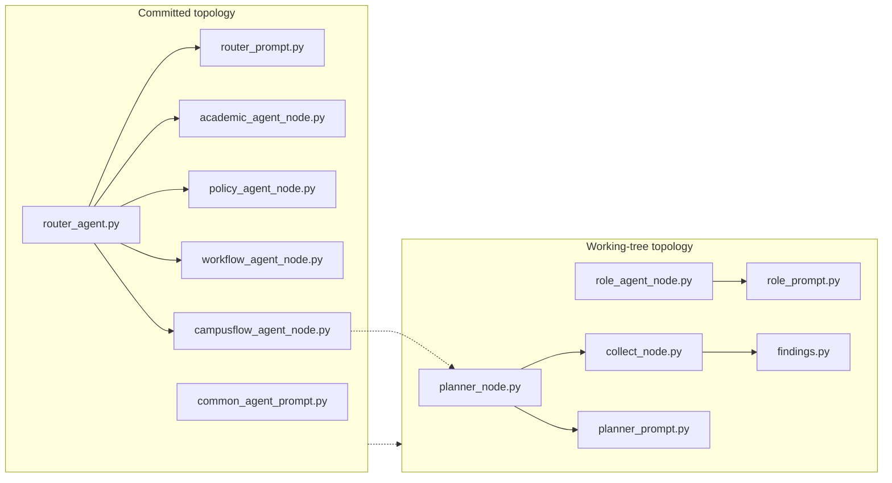

# Agent orchestration in campusflow

**Evidence class:** file-level (paths and Git status). Node contracts, edges, and prompt contents were not readable in this run, so runtime behaviour is inferred and labelled accordingly.

## Runtime pieces

| Piece | Path | Status in this change set |
| --- | --- | --- |
| Graph builder | `src/graph/create_Graph.py` | modified |
| Shared state | `src/agent/state/common_state.py` | modified |
| Nodes | `src/agent/nodes/campusflow_agent_node.py` | modified |
| Nodes | `src/agent/nodes/academic_agent_node.py`, `policy_agent_node.py` | staged deletions |
| Nodes | `src/agent/nodes/workflow_agent_node.py` | unstaged deletion |
| Nodes | `src/agent/nodes/planner_node.py`, `role_agent_node.py`, `collect_node.py` | staged additions, deleted in working tree |
| Prompts | `src/agent/prompt/common_agent_prompt.py` | modified |
| Prompts | `src/agent/prompt/router_prompt.py` | staged deletion |
| Prompts | `src/agent/prompt/workflow_agent_prompt.py` | unstaged deletion |
| Prompts | `src/agent/prompt/planner_prompt.py`, `role_prompt.py` | staged additions, deleted in working tree |
| Prompts | `src/agent/prompt/chat_agent_prompt.py`, `document_match.py`, `temp_match.py`, `subagent_prompts.py` | committed set, plus one new untracked file |
| Router | `src/agent/router_agent.py` | staged deletion |
| LLM node | `src/agent/llm/llm_node.py` | modified |
| LLM client | `src/agent/llm/chat_model.py` | new, untracked |
| Findings buffer | `src/agent/findings.py` | staged addition, deleted in working tree |

The committed node set (`academic`, `policy`, `workflow`, `campusflow`) plus `src/agent/router_agent.py` and `router_prompt.py` is the **original** fixed-domain topology: one router agent dispatching into campus-domain agent nodes, each paired with its own prompt module.

## The pivot in flight

The working tree is replacing that topology with a planner / role / collect set:

Topology change recorded by Git status: committed router/domain-agent files are deleted, planner/role/collect files are staged additions with no working-tree copy. Arrows are layout inference, not verified graph edges.

Three evidence-backed observations:

1. **The change is not a rename.** The router and three of four domain agents disappear, and `campusflow_agent_node.py` — the only surviving domain node — is modified rather than deleted, so it is being retained in some role while its siblings are retired.
2. **The new files are not on disk.** `planner_node.py`, `role_agent_node.py`, `collect_node.py`, `planner_prompt.py`, `role_prompt.py`, and `findings.py` show status `AD` (index-add plus working-tree delete). The staged architecture therefore does not match the code a run would import, and a commit today would add files that do not exist in the working tree. See [repo state and work in flight](../operations/repo-state.md).
3. **State and prompts changed together.** `common_state.py` and `common_agent_prompt.py` are modified in the same change set as the node rotation, which is the pattern expected when shared state keys and shared prompt scaffolding are retargeted for the new node set. The new `findings.py` name (plus `collect_node.py`) suggests the new loop accumulates intermediate findings rather than dispatching to a domain specialist per request — `source-backed` interpretation, not verified.

## Supporting agent infrastructure

- `src/agent/llm/chat_model.py` (new) sits beside the modified `llm_node.py`, which is consistent with a separate chat-model client being factored out of the graph node.
- `src/agent/prompt/subagent_prompts.py` (new) is consistent with subagents being spawned from the node loop, paired with `src/agent/permissions.py` and `src/agent/approvals.py` for gating.
- `src/agent/store/mongdb_store.py` (new) gives nodes a persistent store, exposed to the graph through `src/agent/tools/store_tool.py`. See [tools and runtime](tools-and-runtime.md).
- `src/agent/rag_worker/ingest_service.py` (new) adds an ingestion path next to the committed `chunk.py`, `extractor.py`, `minio_client.py`, and `repository.py`.

## Open architecture questions

The node contracts, stop conditions, and the fate of `router_agent.py`'s responsibilities are unresolved from this evidence; they are tracked in [open questions](../open-questions.md) under `campusflow-agent-refactor`.

## Related pages

- [Architecture overview](overview.md)
- [Tools and runtime](tools-and-runtime.md)
- [Data and persistence](data-and-persistence.md)
- [Repo state and work in flight](../operations/repo-state.md)
