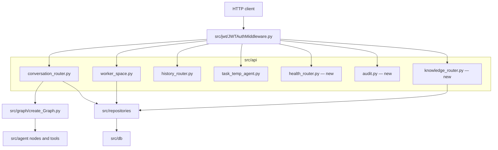

# API and runtime surface in campusflow

**Evidence class:** file-level (paths and Git status). Router paths, request models, and middleware behaviour were not readable in this run.

## Entrypoints

| Path | Status | Notes |
| --- | --- | --- |
| `src/main.py` | modified | Primary application entrypoint; also mounts/starts the API surface. |
| `src/my_project.py` | committed | Secondary module from the initial import. |
| `run.py` | new, untracked | A run script added at the repo root next to `uv.lock`. |
| `test_main.http` | committed | HTTP request scratch file shipped with the initial import. |

## Router inventory

| Router | Status | Inferred concern |
| --- | --- | --- |
| `src/api/conversation_router.py` | modified | Conversations and message exchange. |
| `src/api/worker_space.py` | modified | Worker-space endpoints; now paired with the new `repositories/workspace_browse_repo.py`. |
| `src/api/history_router.py` | committed | History retrieval. |
| `src/api/task_temp_agent.py` | committed | Task templates / temporary agent tasks. |
| `src/api/agent_router.py` | staged deletion | The agent-specific HTTP surface is being removed, consistent with agent access being folded into conversation or workspace endpoints. |
| `src/api/audit.py` | new, untracked | Audit surface, consistent with the new `agent/approvals.py` gating. |
| `src/api/health_router.py` | new, untracked | Health/readiness endpoint. |
| `src/api/knowledge_router.py` | new, untracked | Knowledge base endpoints, consistent with `db/db_Knowledge.py` and the RAG worker. |

Auth is handled by `src/jwt/JWTAuthMiddleware.py` from the initial import; the middleware file itself is unchanged in this change set, so authentication behaviour is not part of the refactor.

## Request path as diagrammed by the layout

Request path implied by the router, repository, and middleware file layout; not a verified call trace.

Note that `src/api/agent_router.py` is being deleted while `src/api/conversation_router.py` is modified in the same change set — the agent invocation path moves from a dedicated agent router into the conversation surface. This is `source-backed` inference from the two status entries, not verified from source.

## Framework note

The layout — an `api/` package of routers, a JWT ASGI middleware, `main.py` as the app object, and a `test_main.http` scratch file — is the shape of a FastAPI/Starlette service. The framework itself is not declared anywhere in this evidence, so treat "FastAPI" as an inference; `pyproject.toml` is modified but its contents were not readable in this run.

## Related pages

- [Architecture overview](overview.md)
- [Data and persistence](data-and-persistence.md)
- [Agent orchestration](agent-orchestration.md)
- [Tools and runtime](tools-and-runtime.md)
