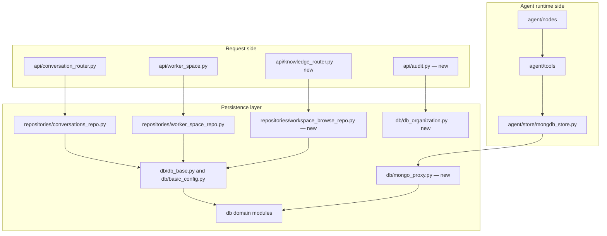

# Data and persistence in campusflow

**Evidence class:** file-level (paths and Git status). Table schemas, collections, and query behaviour are not verifiable from this evidence.

## Layers

| Layer | Files | Change this run |
| --- | --- | --- |
| Repositories | `src/repositories/conversations_repo.py`, `worker_space_repo.py` | modified |
| Repositories | `src/repositories/workspace_browse_repo.py` | new, untracked |
| Repositories | `src/repositories/tasks_templates_match.py` | committed, unchanged |
| Repositories | `src/repositories/agent_repo.py` | staged deletion |
| DB modules | `src/db/db_user.py` | modified |
| DB modules | `src/db/db_agent.py` | unstaged deletion |
| DB modules | `src/db/mongo_proxy.py`, `src/db/db_organization.py` | new, untracked |
| DB modules | `src/db/basic_config.py`, `db_base.py`, `db_conversation.py`, `db_message.py`, `db_Knowledge.py`, `db_quick_entries.py`, `db_task_temp.py` | committed, unchanged |
| Agent store | `src/agent/store/mongdb_store.py` | staged addition with unstaged modifications |
| Contracts | `src/models/common_responce.py`, `meassage.py`, `page_query_res.py`, `task_temp.py` | committed, unchanged |
| Contracts | `src/models/worker_space_res.py` | unstaged deletion |
| Contracts | `src/schemas/send_messages.py` | committed, unchanged |

Two naming patterns coexist: one DB module per domain under `src/db/` (the committed set), and a repository class per API concern under `src/repositories/`. The change set removes exactly one pair from the agent domain (`db_agent.py` + `agent_repo.py` + `models/worker_space_res.py`) while adding a different, Mongo-oriented persistence path (`db/mongo_proxy.py`, `db/db_organization.py`, `agent/store/mongdb_store.py`).

## Data-access diagram

Layering observed from file paths and Git status; the edges show the wiring this layout implies, not verified call order.

## What is confirmed versus inferred

Confirmed from the change set:

- `src/repositories/agent_repo.py`, `src/db/db_agent.py`, and `src/models/worker_space_res.py` are being retired together — an evidence-backed sign that the agent domain no longer owns its own relational persistence and response model.
- `src/db/mongo_proxy.py` and `src/db/db_organization.py` are new while `src/db/db_user.py` is modified, which places new organization-level data and Mongo access next to the existing user data module.
- `src/repositories/workspace_browse_repo.py` is new alongside a modified `src/api/worker_space.py`, consistent with workspace/workspace-file browsing being added as an API capability.

Inferred (source-backed, not verified):

- The presence of `redis_client.py` / `redis_cache.py`, `chroma_vectorstore.py`, `minio_client.py`, and `mongo_proxy.py` implies runtime dependencies on Redis, Chroma, MinIO, and MongoDB. No connection strings, ports, or collections were readable, and `.env` was deliberately not read — see [open questions](../open-questions.md) under `campusflow-runtime-contracts`.
- `mongdb_store.py` (spelled that way in the repository) appearing under `src/agent/store/` rather than `src/db/` implies agent-scoped persistence — likely conversation or run state — separated from the domain DB modules.

## Related pages

- [Architecture overview](overview.md)
- [API and runtime](api-and-runtime.md)
- [Tools and runtime](tools-and-runtime.md)
- [Repo state and work in flight](../operations/repo-state.md)
