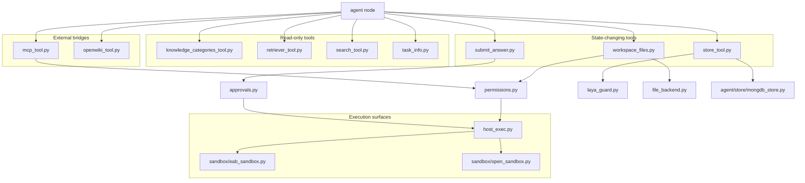

# Tools, retrieval, and agent runtime services in campusflow

**Evidence class:** file-level (paths and Git status). Tool signatures, permission rules, and execution semantics were not readable in this run.

## Tool inventory

| Tool | Path | Status |
| --- | --- | --- |
| Knowledge categories | `src/agent/tools/knowledge_categories_tool.py` | committed |
| Retriever | `src/agent/tools/retriever_tool.py` | committed |
| Web/search | `src/agent/tools/search_tool.py` | committed |
| Task info | `src/agent/tools/task_info.py` | committed |
| MCP client bridge | `src/agent/tools/mcp_tool.py` | new, staged with unstaged modifications |
| OpenWiki bridge | `src/agent/tools/openwiki_tool.py` | new, staged with unstaged modifications |
| Agent store | `src/agent/tools/store_tool.py` | new, staged with unstaged modifications |
| Host execution | `src/agent/tools/host_exec.py` | new, untracked |
| Workspace files | `src/agent/tools/workspace_files.py` | new, untracked |
| Answer submission | `src/agent/tools/submit_answer.py` | new, untracked |
| Guard | `src/agent/tools/laya_guard.py` | new, untracked |

The four committed tools cover read-only capabilities (category listing, retrieval, search, task metadata). Everything added in this change set either reaches outside the process (`mcp_tool`, `openwiki_tool`, `host_exec`) or mutates agent state and files (`store_tool`, `workspace_files`, `submit_answer`), which is why the same change set introduces gating modules.

## Gating, safety, and execution

| Module | Path | Status |
| --- | --- | --- |
| Permission rules | `src/agent/permissions.py` | new, untracked |
| Approvals | `src/agent/approvals.py` | new, untracked |
| File backend | `src/agent/file_backend.py` | new, untracked |
| Context injection | `src/agent/supplement_inject.py` | new, untracked |
| History utilities | `src/agent/history_utils.py` | new, untracked |
| Subagent prompts | `src/agent/prompt/subagent_prompts.py` | new, untracked |
| Sandboxes | `src/agent/sandbox/eab_sandbox.py`, `src/agent/sandbox/open_sandbox.py` | committed |

Capability families and the gating modules implied by the change set; the edges are layout inference, not a verified call trace.

Interpretation to treat as `source-backed` rather than confirmed: the guard name `laya_guard.py` appears together with root-level probes `_laya_guard_selftest.py`, `_laya_toolgate_probe.py`, and `_laya_wiring_selftest.py`, which is consistent with a named internal gate — likely a product or component codename — that restricts which tool calls an agent may make. Nothing in this evidence states what it protects. See [open questions](../open-questions.md) under `campusflow-laya-and-probes`.

## Retrieval, caching, and model stack

| Concern | Paths | Status |
| --- | --- | --- |
| Ingestion | `src/agent/rag_worker/ingest_service.py` | new, untracked |
| Chunking and extraction | `src/agent/rag_worker/chunk.py`, `extractor.py` | committed |
| Object storage | `src/agent/rag_worker/minio_client.py` | committed |
| RAG persistence | `src/agent/rag_worker/repository.py` | committed |
| Vector store | `src/agent/vectorstore/chroma_vectorstore.py` | committed |
| Embeddings | `src/agent/embedding_model/embedding_alli_model.py` | committed |
| Cache | `src/cache/redis_client.py`, `src/agent/cache/redis_cache.py` | committed |
| LLM client | `src/agent/llm/chat_model.py` | new, untracked |
| LLM node | `src/agent/llm/llm_node.py` | modified |
| Knowledge DB | `src/db/db_Knowledge.py` | committed |

`ingest_service.py` is the only new piece of the retrieval stack, which places the current work on wiring ingestion into the new agent loop rather than replacing chunking, embeddings, or the vector store. The knowledge surface is exposed through the new `src/api/knowledge_router.py` — see [API and runtime](api-and-runtime.md) — and persisted through the DB modules in [data and persistence](data-and-persistence.md).

## Repository clutter around the tooling work

These paths are untracked and are evidence of active debugging rather than product code:

- Capability probe and self-test scripts at the repo root: `_shell_cap_probe.py`, `_subagent_perms_selftest.py`, `_laya_probe.py`, `_laya_probe2.py`, `_laya_probe3.py`, `_laya_toolgate_probe.py`, `_laya_guard_selftest.py`, `_laya_wiring_selftest.py`, `_vision_probe.py`, `_vision_fix_selftest.py`, `_kb_docx_probe.py`.
- Retired trees: `_legacy_mq/`, `_legacy_multi_agent/`, `.backup-20260915/`.
- Tooling/config directories and files: `.github/`, `.workbuddy/`, `openwiki/`, `AGENTS.md`, `.gitignore`, `uv.lock`, `run.py`.
- `docs/` (new, untracked): by name the most likely home for architecture or design notes in this repository, but its contents were not readable in this run, so nothing here is documented from it. Its path-level presence, together with `AGENTS.md` and `.github/`, is the only repository-internal signal that written design documentation may exist. Whether it actually contains architecture notes is `watchlist` until a code-mode or contents-bearing run can read it; see the `file-level-evidence-limit` row in [themes](../themes.md).

The `_vision_*` and `_kb_docx_probe.py` names sit outside the graph nodes documented above and are not explained by any other path in this change set; they are recorded as `watchlist` signals.

## Related pages

- [Agent orchestration](agent-orchestration.md)
- [Architecture overview](overview.md)
- [Data and persistence](data-and-persistence.md)
- [Repo state and work in flight](../operations/repo-state.md)
- [Themes](../themes.md)
